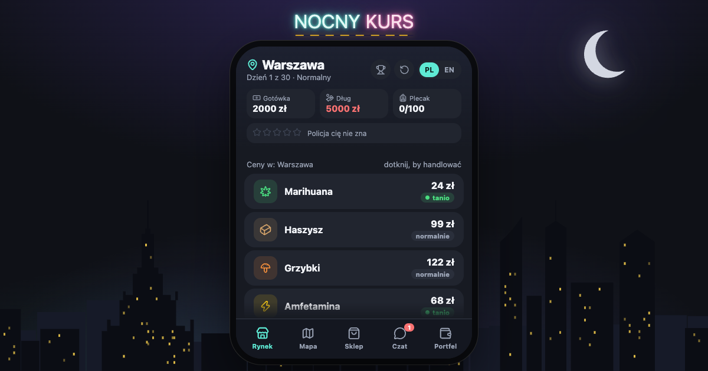

# 🌙 Nocny Kurs / Night Run

Darmowa gra ekonomiczna w przeglądarce: kupuj tanio, sprzedawaj drogo, uciekaj przed policją i spłać Wujka Zbycha w 30 dni. Polskie miasta, nocny klimat, PL i EN.

**Zagraj:** https://jbutton.github.io/nocny-kurs/ · **English:** https://jbutton.github.io/nocny-kurs/en/



> 18+. Gra jest fikcją i satyrą. Nie zachęca do łamania prawa — pokazuje ryzyko i konsekwencje.

## Co jest w grze

- 8 towarów i 8 miast (Warszawa, Kraków, Gdańsk, Szczecin, Wrocław, Poznań, Łódź, Katowice), każde z nocną panoramą
- Poziom poszukiwania (gwiazdki), kontrole policji, napady, jazda na gapę
- Recepta na medyczną marihuanę: klinika, apteka, teleporada
- Sklep: większy plecak, skuter, auto, dostawczak, ochrona
- Dług u Wujka Zbycha: spłata, pożyczki, windykacja, bankructwo
- 3 poziomy trudności, samouczek, automatyczny zapis, ranking z nickiem
- Pełna wersja polska i angielska, przełączana w trakcie gry

## Technologia

[Astro](https://astro.build) (statyczny build) + [Svelte 5](https://svelte.dev) + [TanStack Store](https://tanstack.com/store) + [Lucide](https://lucide.dev).

```
src/game/        logika gry w czystym TypeScripcie (bez UI) — stan + akcja → nowy stan
src/i18n/        teksty PL i EN
src/stores/      TanStack Store: stan aplikacji, akcje, autozapis
src/components/  komponenty Svelte 5
src/pages/       strony Astro: / (PL) i /en/ (EN)
tests/           testy logiki (Vitest)
e2e/             testy w przeglądarce (Playwright)
GDD.md           dokument projektowy gry
```

## Uruchomienie

```bash
npm install
npm run dev        # http://localhost:4321/nocny-kurs/
npm test           # testy logiki
npm run test:e2e   # build + testy w przeglądarce (wymaga Google Chrome)
npm run build      # wersja produkcyjna do dist/
```

Każdy push na `main` uruchamia testy i wdraża grę na GitHub Pages (`.github/workflows/deploy.yml`).

## Licencja

[MIT](LICENSE)
