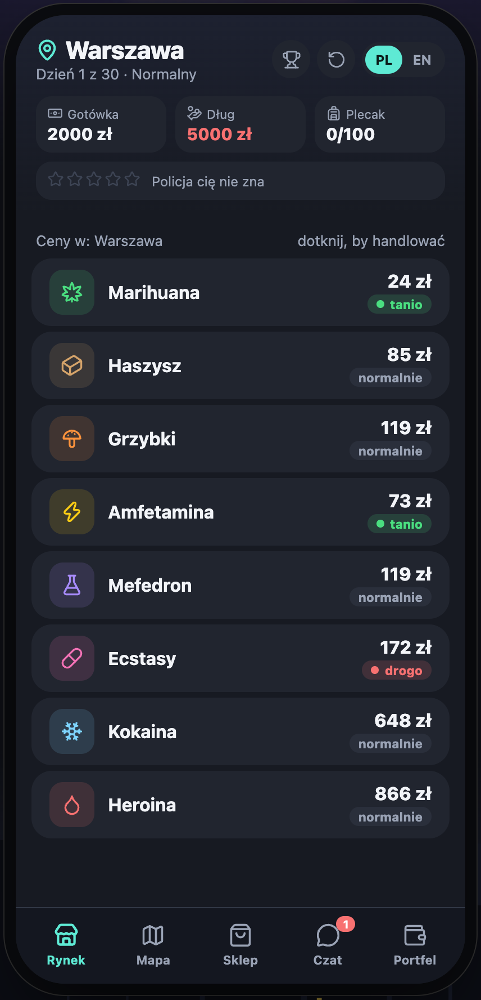
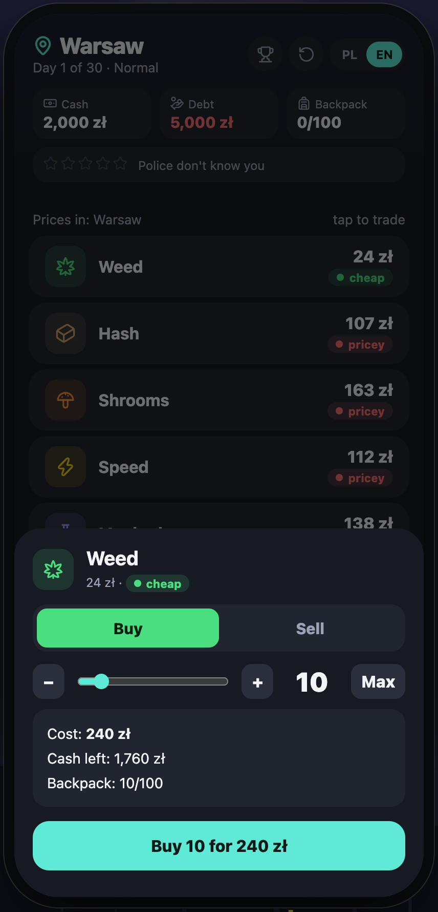
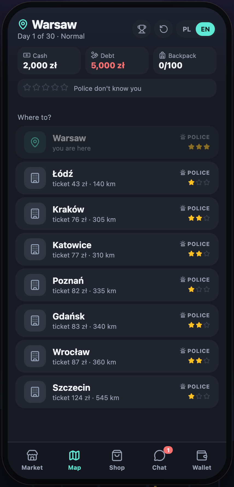

# 🌙 Night Run / Nocny Kurs

A free browser trading game: buy low, sell high, dodge the police and pay off Uncle Zbych in 30 days. Set in Polish cities at night, playable in English and Polish.

**Play:** https://jbutton.github.io/nocny-kurs/en/ · **Po polsku:** https://jbutton.github.io/nocny-kurs/

<p align="center">
  
  
  
</p>

> 18+. The game is fiction and satire. It doesn't encourage breaking the law; it shows the risks and the consequences.

## Features

- 8 goods and 8 cities (Warsaw, Kraków, Gdańsk, Szczecin, Wrocław, Poznań, Łódź, Katowice), each with its own night skyline
- Wanted level (stars), police checks, robberies, riding without a ticket
- Medical cannabis prescription: clinic, pharmacy, telehealth renewal
- Shop: bigger backpack, scooter, car, delivery van, protection
- Debt to Uncle Zbych: repay, borrow, debt collectors, bankruptcy
- 3 difficulty levels, tutorial, autosave
- Online leaderboard with cheat protection: the dice are rolled on the server only after you commit to a move, so the future can't be predicted even with the source code; the server replays the whole game and computes the score itself
- Full English and Polish versions, switchable mid-game
- No cookies, no tracking — everything is stored locally in the browser

## Tech stack

[Astro](https://astro.build) (static build) + [Svelte 5](https://svelte.dev) + [TanStack Store](https://tanstack.com/store) + [Lucide](https://lucide.dev) icons. Online leaderboard: [Cloudflare Workers](https://workers.cloudflare.com) + D1, fetched with [TanStack Query](https://tanstack.com/query).

```
src/game/        game logic in plain TypeScript (no UI) — state + action → new state
src/game/replay.ts  move log + replay, shared by the game and the leaderboard server
src/game/run.ts     ranked game protocol: server-side randomness revealed after each decision
worker/          leaderboard API (Cloudflare Worker + D1)
src/i18n/        Polish and English texts
src/stores/      TanStack Store: app state, actions, autosave
src/components/  Svelte 5 components
src/pages/       Astro pages: / (Polish) and /en/ (English)
tests/           game logic tests (Vitest)
e2e/             browser tests (Playwright)
GDD.md           game design document (in Polish)
```

## Getting started

```bash
npm install
npm run dev        # http://localhost:4321/nocny-kurs/
npm test           # game logic tests
npm run test:e2e   # build + browser tests (requires Google Chrome)
npm run build      # production build in dist/
npm run api:dev    # leaderboard API locally (http://localhost:8787)
npm run api:deploy # deploy the leaderboard API to Cloudflare
```

Every push to `main` runs the tests and deploys the game to GitHub Pages (`.github/workflows/deploy.yml`).

## License

[MIT](LICENSE)
